# TOACD — Complete System Architecture & Workflow

## AI-Automated & Self-Healing C++ Compiler-Debugger

> An end-to-end, AI-powered C++ development environment with chatbot-driven debugging, multi-stage reasoning, live code suggestions, security hardening, semantic analysis, and agentic LLDB debugging — all served through a Streamlit UI.

---

## 1. High-Level System Architecture

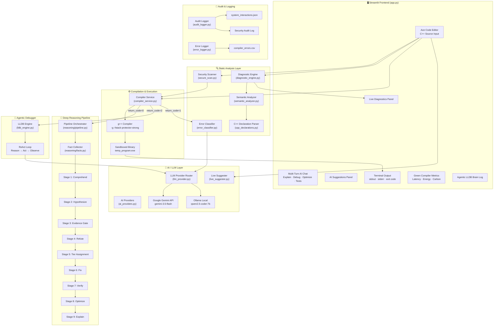

---

## 2. Module Inventory & Responsibilities

| Module | File | Lines | Purpose |
|---|---|---|---|
| **Main Application** | [`app.py`](file:///c:/TOACD_PROJECT_FINAL/TOACD_PROJECT/TOACD_PROJECT/Chatbot-Driven-Compiler-Debugger/app.py) | 1383 | Streamlit UI orchestrator — editor, chat, compile flow, diagnostics, AI suggestions |
| **AI Providers** | [`ai_providers.py`](file:///c:/TOACD_PROJECT_FINAL/TOACD_PROJECT/TOACD_PROJECT/Chatbot-Driven-Compiler-Debugger/ai_providers.py) | 353 | `LLMProvider` base class + `OllamaProvider`, `GeminiProvider`, `GroqProvider`, `OpenRouterProvider` |
| **LLM Provider Router** | [`llm_provider.py`](file:///c:/TOACD_PROJECT_FINAL/TOACD_PROJECT/TOACD_PROJECT/Chatbot-Driven-Compiler-Debugger/llm_provider.py) | 556 | Task-aware routing (Gemini-first, Ollama-fallback), SHA-256 disk+memory caching, structured output |
| **Compiler Service** | [`compiler_service.py`](file:///c:/TOACD_PROJECT_FINAL/TOACD_PROJECT/TOACD_PROJECT/Chatbot-Driven-Compiler-Debugger/compiler_service.py) | 149 | Sandboxed compile (`g++ -g -fstack-protector-strong`) and execute with `RunResult` tuple |
| **Diagnostic Engine** | [`diagnostic_engine.py`](file:///c:/TOACD_PROJECT_FINAL/TOACD_PROJECT/TOACD_PROJECT/Chatbot-Driven-Compiler-Debugger/diagnostic_engine.py) | 798 | Brace balance, security checks, compiler syntax checks, semantic conversion, HTML rendering |
| **Security Scanner** | [`secure_scan.py`](file:///c:/TOACD_PROJECT_FINAL/TOACD_PROJECT/TOACD_PROJECT/Chatbot-Driven-Compiler-Debugger/secure_scan.py) | 139 | 50+ regex patterns: memory safety, OS commands, network, filesystem, shellcode, registry |
| **Semantic Analyzer** | [`semantic_analyzer.py`](file:///c:/TOACD_PROJECT_FINAL/TOACD_PROJECT/TOACD_PROJECT/Chatbot-Driven-Compiler-Debugger/semantic_analyzer.py) | 482 | Deterministic name/type mismatch detection with semantic dictionary matching |
| **C++ Declarations** | [`cpp_declarations.py`](file:///c:/TOACD_PROJECT_FINAL/TOACD_PROJECT/TOACD_PROJECT/Chatbot-Driven-Compiler-Debugger/cpp_declarations.py) | 448 | Conservative C++ tokenizer and variable-declaration extractor |
| **Error Classifier** | [`error_classifier.py`](file:///c:/TOACD_PROJECT_FINAL/TOACD_PROJECT/TOACD_PROJECT/Chatbot-Driven-Compiler-Debugger/error_classifier.py) | 65 | Rule-based GCC error categorization (Syntax, Linker, Type, Runtime, Security) |
| **Fix Engine** | [`fix_engine.py`](file:///c:/TOACD_PROJECT_FINAL/TOACD_PROJECT/TOACD_PROJECT/Chatbot-Driven-Compiler-Debugger/fix_engine.py) | 25 | Extracts LLM-suggested code blocks and validates against security scanner |
| **LLDB Engine** | [`lldb_engine.py`](file:///c:/TOACD_PROJECT_FINAL/TOACD_PROJECT/TOACD_PROJECT/Chatbot-Driven-Compiler-Debugger/lldb_engine.py) | 156 | Agentic ReAct loop — AI autonomously runs LLDB `bt`, `frame variable` commands |
| **Live Suggester** | [`live_suggester.py`](file:///c:/TOACD_PROJECT_FINAL/TOACD_PROJECT/TOACD_PROJECT/Chatbot-Driven-Compiler-Debugger/live_suggester.py) | 498 | Real-time AI code suggestions with range resolution, scope awareness, thread safety |
| **Audit Logger** | [`audit_logger.py`](file:///c:/TOACD_PROJECT_FINAL/TOACD_PROJECT/TOACD_PROJECT/Chatbot-Driven-Compiler-Debugger/audit_logger.py) | 58 | JSON interaction log + dedicated security audit trail |
| **Error Logger** | [`error_logger.py`](file:///c:/TOACD_PROJECT_FINAL/TOACD_PROJECT/TOACD_PROJECT/Chatbot-Driven-Compiler-Debugger/error_logger.py) | 59 | CSV-format compiler error dataset with GCC output parsing |
| **UI Themes** | [`ui_themes.py`](file:///c:/TOACD_PROJECT_FINAL/TOACD_PROJECT/TOACD_PROJECT/Chatbot-Driven-Compiler-Debugger/ui_themes.py) / [`ui_theme.py`](file:///c:/TOACD_PROJECT_FINAL/TOACD_PROJECT/TOACD_PROJECT/Chatbot-Driven-Compiler-Debugger/ui_theme.py) | 20964 / 10339 | Theming engine with multiple schemes, status banners, badges, severity blocks |
| **Reasoning Pipeline** | [`reasoning/pipeline.py`](file:///c:/TOACD_PROJECT_FINAL/TOACD_PROJECT/TOACD_PROJECT/Chatbot-Driven-Compiler-Debugger/reasoning/pipeline.py) | 579 | 10-stage orchestrator with per-stage time budgets and graceful degradation |
| **Reasoning Models** | [`reasoning/models.py`](file:///c:/TOACD_PROJECT_FINAL/TOACD_PROJECT/TOACD_PROJECT/Chatbot-Driven-Compiler-Debugger/reasoning/models.py) | 219 | `Fact`, `FactBundle`, `Candidate`, `Finding`, `Tier`, `ReasoningResult` data models |
| **Reasoning Adapters** | [`reasoning/adapters.py`](file:///c:/TOACD_PROJECT_FINAL/TOACD_PROJECT/TOACD_PROJECT/Chatbot-Driven-Compiler-Debugger/reasoning/adapters.py) | 148 | Convert `Finding` → diagnostic dicts, chat messages, patch code |
| **Syntax Tree** | [`reasoning/syntax_tree.py`](file:///c:/TOACD_PROJECT_FINAL/TOACD_PROJECT/TOACD_PROJECT/Chatbot-Driven-Compiler-Debugger/reasoning/syntax_tree.py) | 242 | tree-sitter C++ front-end with fallback to `cpp_declarations` |
| **Evidence Gate** | [`reasoning/evidence_gate.py`](file:///c:/TOACD_PROJECT_FINAL/TOACD_PROJECT/TOACD_PROJECT/Chatbot-Driven-Compiler-Debugger/reasoning/evidence_gate.py) | 112 | Mechanical checks on LLM candidates before refutation |
| **Tier Policy** | [`reasoning/tier_policy.py`](file:///c:/TOACD_PROJECT_FINAL/TOACD_PROJECT/TOACD_PROJECT/Chatbot-Driven-Compiler-Debugger/reasoning/tier_policy.py) | 111 | Epistemic policy: evidence → certainty ceiling → tier assignment |
| **Reasoning Config** | [`reasoning/config.py`](file:///c:/TOACD_PROJECT_FINAL/TOACD_PROJECT/TOACD_PROJECT/Chatbot-Driven-Compiler-Debugger/reasoning/config.py) | 44 | Environment-driven profile/stage/timeout configuration |
| **Refuter** | [`reasoning/refuter.py`](file:///c:/TOACD_PROJECT_FINAL/TOACD_PROJECT/TOACD_PROJECT/Chatbot-Driven-Compiler-Debugger/reasoning/refuter.py) | — | LLM-powered counter-argument generation against candidates |
| **Dataflow** | [`reasoning/dataflow.py`](file:///c:/TOACD_PROJECT_FINAL/TOACD_PROJECT/TOACD_PROJECT/Chatbot-Driven-Compiler-Debugger/reasoning/dataflow.py) | — | Variable read/write tracking and uninitialized-read detection |
| **Probes** | [`reasoning/probes.py`](file:///c:/TOACD_PROJECT_FINAL/TOACD_PROJECT/TOACD_PROJECT/Chatbot-Driven-Compiler-Debugger/reasoning/probes.py) | — | Deterministic fact-checking probes (line_exists, snippet_present, variable_exists) |
| **Patching** | [`reasoning/patching.py`](file:///c:/TOACD_PROJECT_FINAL/TOACD_PROJECT/TOACD_PROJECT/Chatbot-Driven-Compiler-Debugger/reasoning/patching.py) | — | Line-level source code patch application |

---

## 3. Core Architectural Principles

### 3.1 Defense-in-Depth Security

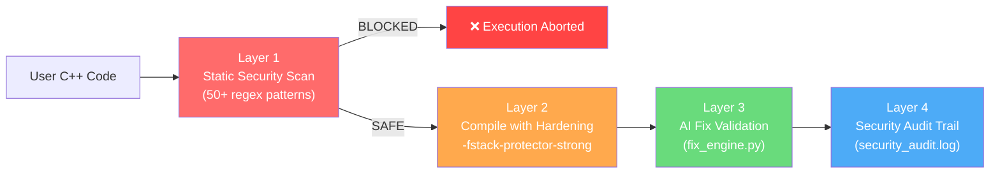

The security scanner inspects code **before any compilation or execution** for:

| Category | Patterns | Examples |
|---|---|---|
| Memory Safety | 8 patterns | `gets()`, `strcpy`, `sprintf`, `auto_ptr` |
| OS Command Execution | 14 patterns | `system()`, `popen()`, `fork()`, `CreateProcess` |
| Format String Vulns | 3 patterns | `printf(var)`, `fprintf(file, var)` |
| Network Exfiltration | 7 patterns | `socket()`, `connect()`, `WSAStartup` |
| Filesystem Tampering | 6 patterns | `../` traversal, system path access, `DeleteFile` |
| Dynamic Loading | 4 patterns | `LoadLibrary`, `dlopen`, `GetProcAddress` |
| Shellcode/Assembly | 4 patterns | `__asm__`, `VirtualAlloc`, `mprotect` |
| Registry/Hooks | 3 patterns | `RegOpenKey`, `SetWindowsHookEx` |
| Macro Aliasing | 1 pattern | `#define alias system` |
| Compiler DoS | 2 patterns | `#include CON`, `#include __FILE__` |

### 3.2 Gemini-First / Ollama-Fallback Architecture

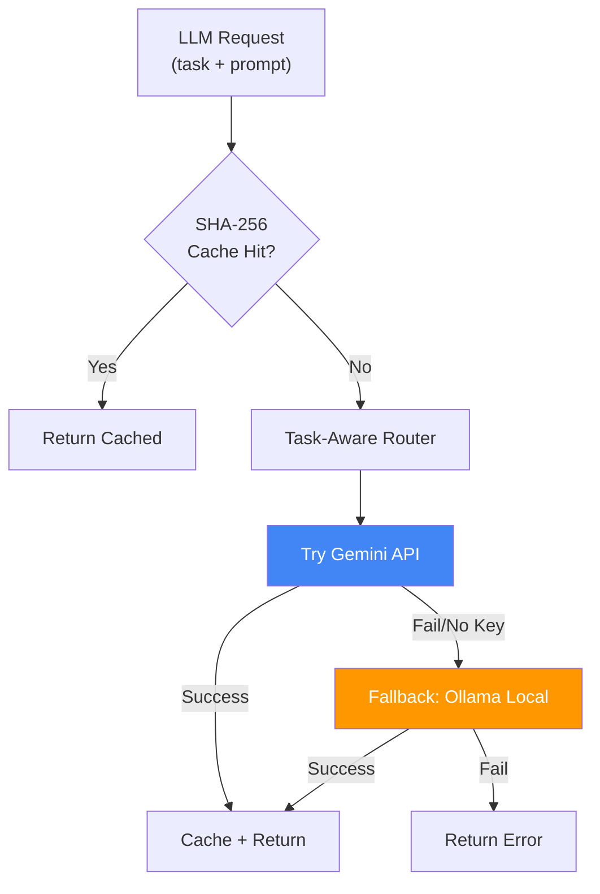

**Task-specific token budgets:**

| Task | Gemini Max Tokens | Ollama Max Tokens |
|---|---|---|
| `live_suggestions` | 1024 | 400 |
| `optimal_code` | 2048 | 1200 |
| `chat` | 2048 | 512 |
| `reasoning` | 1024 | 512 |

### 3.3 Self-Healing Pipeline

The system automatically detects and corrects errors through a multi-stage self-healing loop:

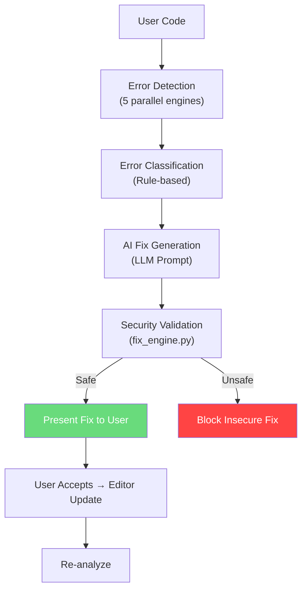

---

## 4. Complete Workflow: The Compile & Analyze Pipeline

### 4.1 Button Press → Results (End-to-End Flow)

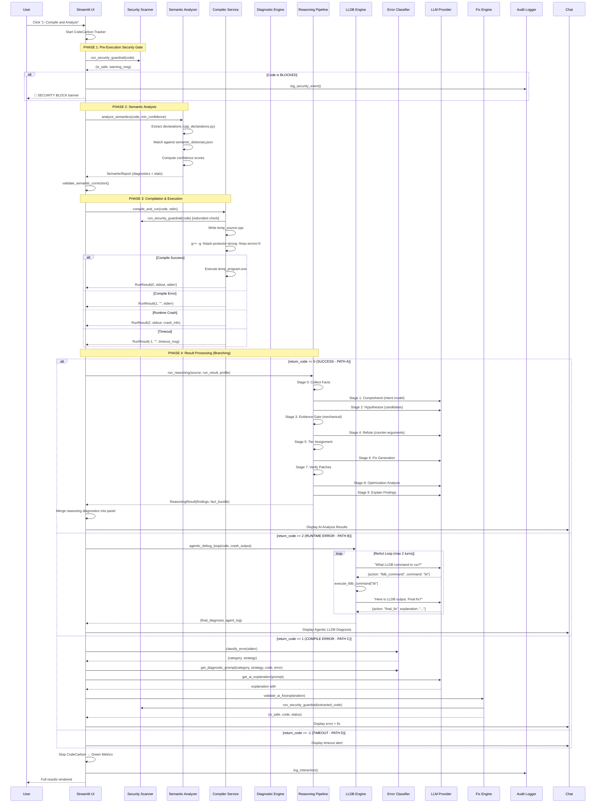

---

## 5. The 10-Stage Deep Reasoning Pipeline

The reasoning engine is the core differentiator — a multi-stage, evidence-grounded analysis pipeline that goes far beyond simple LLM prompting.

```mermaid
graph TD
    subgraph Input
        Source["C++ Source Code"]
        RunResult["Compile/Run Result"]
    end

    subgraph Stage0["Stage 0: Fact Collection (Deterministic)"]
        S0A["Parse source with tree-sitter"]
        S0B["Extract compiler warnings (-Wall -Wextra)"]
        S0C["Build dataflow events"]
        S0D["Enumerate declarations & scopes"]
        S0E["Output: FactBundle"]
    end

    subgraph Stage1["Stage 1: Comprehend (LLM)"]
        S1A["Generate intent model"]
        S1B["Identify variable roles"]
        S1C["Flag unknowns"]
        S1D["Output: IntentModel"]
    end

    subgraph Stage2["Stage 2: Hypothesize (LLM)"]
        S2A["Generate candidate issues"]
        S2B["Each has: claim, kind, lines, snippet, fact_ids"]
        S2C["LLM proposes tier + falsifier"]
        S2D["Output: list[Candidate]"]
    end

    subgraph Stage3["Stage 3: Evidence Gate (Deterministic)"]
        S3A["Check: cited lines exist?"]
        S3B["Check: snippet present at line?"]
        S3C["Check: fact IDs valid?"]
        S3D["Check: variables exist in AST?"]
        S3E["Run claim-specific probes"]
        S3F["Output: pass / reject / downgrade"]
    end

    subgraph Stage4["Stage 4: Refute (LLM, Parallelized)"]
        S4A["For each surviving candidate"]
        S4B["LLM tries to find counter-argument"]
        S4C["Output: holds / refuted / uncertain"]
    end

    subgraph Stage5["Stage 5: Tier Assignment (Deterministic)"]
        S5A["Compute evidence ceiling"]
        S5B["Compare LLM proposal vs ceiling"]
        S5C["Apply intent/gate/refutation downgrades"]
        S5D["Output: final Tier per finding"]
    end

    subgraph Stage6["Stage 6: Fix (LLM, Parallelized)"]
        S6A["Generate PatchEdit for fixable findings"]
        S6B["Only for DEFINITE_ERROR, DEFINITE_BUG, LIKELY_BUG"]
    end

    subgraph Stage7["Stage 7: Verify (Deterministic)"]
        S7A["V0: Patch applies cleanly?"]
        S7B["V1: Scope check (no side effects?)"]
        S7C["V2: Security scan on patched code"]
    end

    subgraph Stage8["Stage 8: Optimize (LLM)"]
        S8A["Only if no DEFINITE_ERROR findings"]
        S8B["Analyze time/space complexity"]
        S8C["Suggest algorithmic alternatives"]
    end

    subgraph Stage9["Stage 9: Explain (LLM, Parallelized)"]
        S9A["Generate human-readable explanation"]
        S9B["Per-finding beginner-friendly text"]
    end

    Source --> Stage0
    RunResult --> Stage0
    Stage0 --> Stage1
    Stage1 --> Stage2
    Stage2 --> Stage3
    Stage3 --> Stage4
    Stage4 --> Stage5
    Stage5 --> Stage6
    Stage6 --> Stage7
    Stage7 --> Stage8
    Stage8 --> Stage9

    style Stage0 fill:#1a1a2e,color:#e94560
    style Stage3 fill:#1a1a2e,color:#0f3460
    style Stage5 fill:#1a1a2e,color:#0f3460
    style Stage7 fill:#1a1a2e,color:#0f3460
```

### 5.1 Tier System (Certainty Classification)

The tier system is an **epistemic policy** — it prevents the LLM from overclaiming certainty:

| Tier | Icon | Meaning | Evidence Required |
|---|---|---|---|
| `DEFINITE_ERROR` | ❌ | Confirmed by compiler | Compiler error fact |
| `DEFINITE_BUG` | 🐛 | Proven bug | Compiler warning + probe confirmation |
| `LIKELY_BUG` | ⚠️ | Probable bug | Compiler "may be" warning |
| `POSSIBLE_ISSUE` | ❓ | Uncertain | LLM claim with valid citation |
| `CODE_SMELL` | 👃 | Maintainability | Pattern-based |
| `OPTIMIZATION` | ⚡ | Performance | Complexity analysis |
| `STYLE` | 💡 | Readability | Stylistic |

**Ceiling Rules:**
- Compiler error → ceiling = `DEFINITE_ERROR`
- Compiler definite warning / probe confirmed → ceiling = `DEFINITE_BUG`
- Compiler "may be" warning → ceiling = `LIKELY_BUG`
- LLM-only claims → ceiling = `POSSIBLE_ISSUE`
- Intent-dependent claims → capped at `LIKELY_BUG`
- Gate downgrade → one tier lower
- Refuter uncertainty → one tier lower

### 5.2 Profile System

| Profile | Stages Included | Use Case |
|---|---|---|
| **Quick** | comprehend, hypothesize, evidence_gate, tier, explain | Clean runs (return_code=0, no stderr) |
| **Standard** | Quick + refute, fix, verify | Default for error runs |
| **Thorough** | Standard + optimize | Full analysis on demand |

**Time Budgets:** Global = 30s, per-stage = 8–12s

---

## 6. Live Diagnostics System

### 6.1 Real-Time Analysis Flow

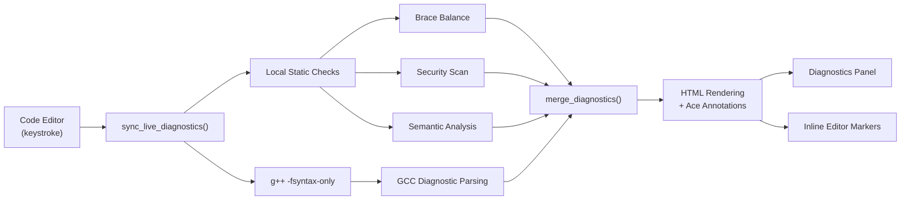

### 6.2 Diagnostic Categories (Priority Order)

| Priority | Category | Icon | Label |
|---|---|---|---|
| 0 | `ERROR` | ❌ | SYNTAX ERROR |
| 1 | `BUG` | 🐛 | BUG |
| 2 | `SECURITY_CRITICAL` | 🚫 | SECURITY WARNING |
| 3 | `LIKELY_BUG` | ⚠️ | LIKELY BUG |
| 4 | `SECURITY_WARNING` | ⚠️ | SECURITY WARNING |
| 5 | `WARNING` | ⚠️ | WARNING |
| 6 | `POTENTIAL_ISSUE` | ❓ | POTENTIAL ISSUE |
| 7 | `SMELL` | 👃 | CODE SMELL |
| 8 | `OPTIMIZATION` | ⚡ | OPTIMIZATION |
| 9 | `SUGGESTION` | 💡 | SUGGESTION |

---

## 7. Semantic Analysis Engine

### 7.1 How It Works

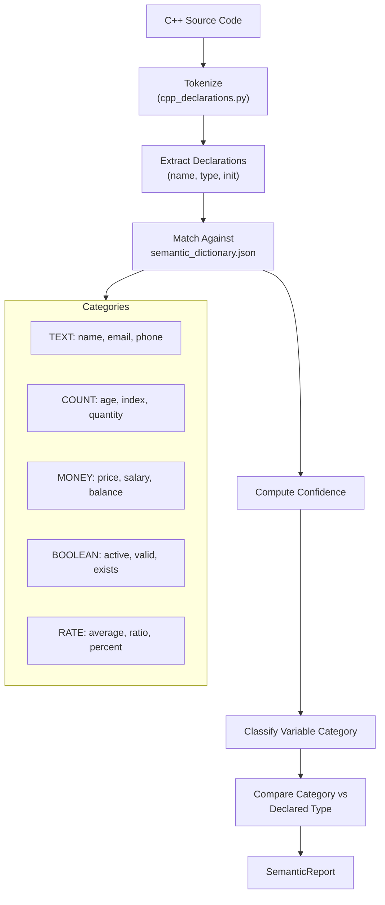

**Example Detection:**
```cpp
int email = 42;        // → "email" matches TEXT category → expected std::string → WARNING
double count = 3.14;   // → "count" matches COUNT category → expected int → WARNING
```

**Confidence Levels:**
- `HIGH` (≥75%): Expanded expander, shown prominently
- `MEDIUM` (50–75%): Collapsed expander
- `LOW` (30–50%): Only with minimum confidence setting

### 7.2 Auto-Correction Flow

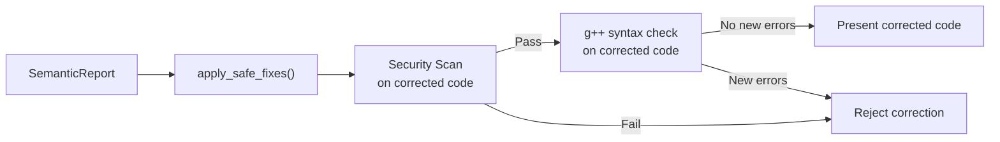

---

## 8. Live AI Suggestions Engine

### 8.1 Suggestion Generation Flow

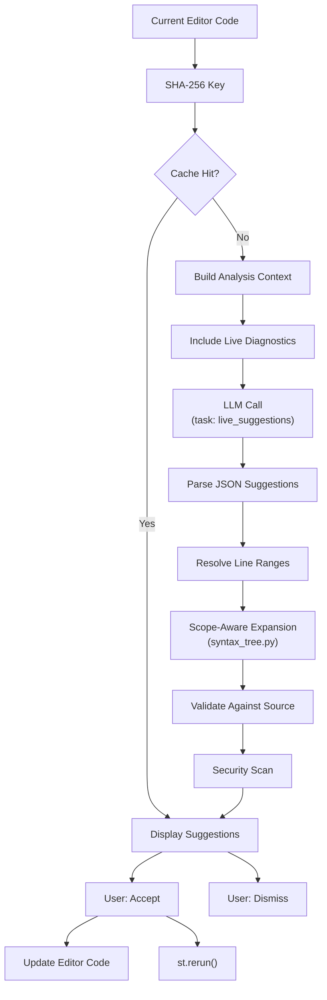

### 8.2 Optimal Code Generation

A secondary feature generates a **complete optimized rewrite** of the program:
1. Analyzes current code + diagnostics + execution result
2. Requests full program rewrite from LLM
3. Validates rewritten code against security scanner
4. Presents with change list and verification status
5. User can apply to editor with one click

---

## 9. Agentic LLDB Debugger (ReAct Pattern)

### 9.1 Autonomous Debugging Loop

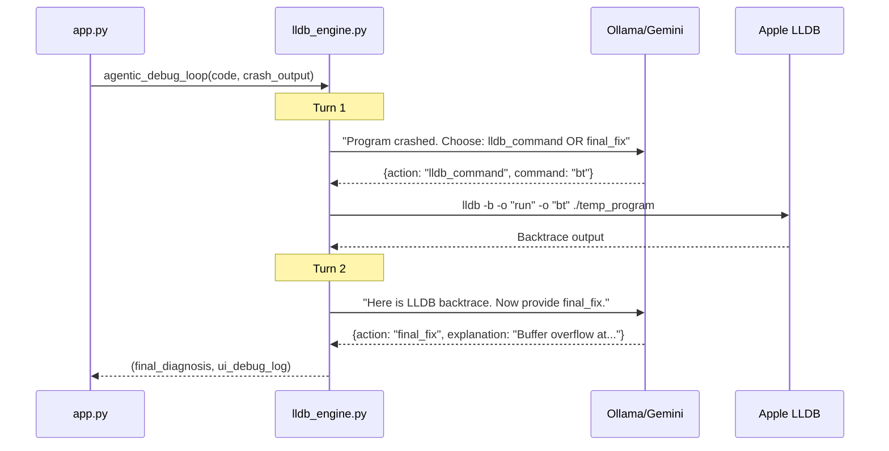

**Key Design Decisions:**
- Maximum **2 turns** to prevent infinite loops
- LLDB runs in **batch mode** (`-b` flag) to prevent interactive terminal freeze
- Debug symbols enabled via `-g` compiler flag
- Full thought process logged in `ui_debug_log` for transparency

---

## 10. Multi-Turn AI Chat System

### 10.1 Chat Architecture

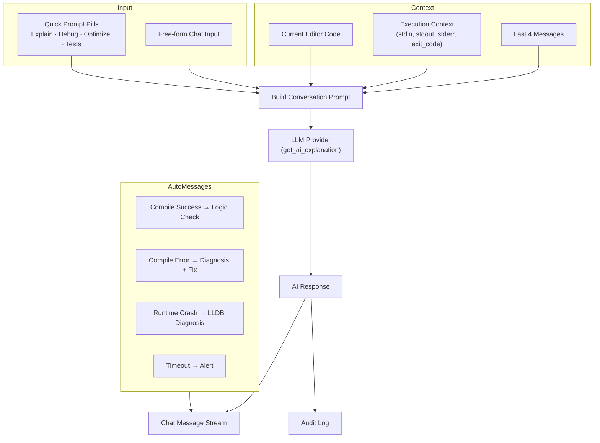

### 10.2 Prompt Engineering

The system uses **highly-constrained system prompts** for each scenario:

- **Compile Error**: Category-specific teaching strategy (Syntax, Linker, Type, Runtime, Security)
- **Logic Check**: Reasons about stdin/stdout correctness
- **ReAct Agent**: Strict JSON output format with `thought/action/command/explanation`
- **Chat Follow-up**: Includes code + execution context + last 4 messages

---

## 11. Data & Storage Architecture

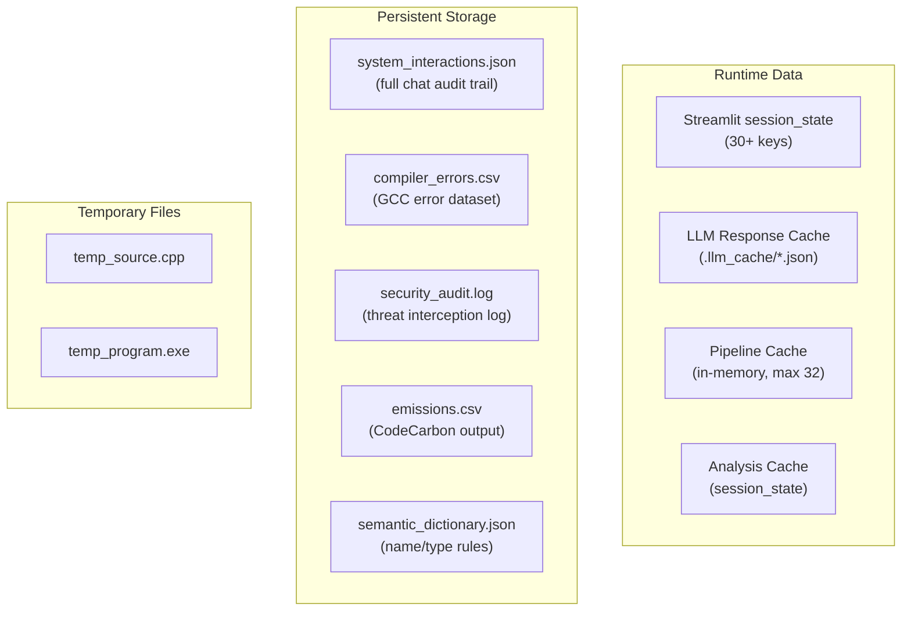

### 11.1 Session State Keys (Key Subset)

| Key | Type | Purpose |
|---|---|---|
| `editor_code` | `str` | Current editor content |
| `editor_version` | `int` | Incremented on editor updates (forces re-render) |
| `messages` | `list[dict]` | Full chat history |
| `last_status` | `int` | Last compile result (0/1/2/-1) |
| `live_diagnostics` | `list[dict]` | Current merged diagnostics |
| `semantic_report` | `SemanticReport` | Latest semantic analysis |
| `live_suggestions_cache` | `list[dict]` | Current AI suggestions |
| `live_ai_provider` | `str` | "gemini" or "ollama" |
| `green_metrics` | `dict` | Latency/energy/carbon metrics |
| `last_agent_log` | `str` | LLDB debug trace |
| `complete_optimal_code` | `dict` | Generated optimal program |

---

## 12. UI Layout Architecture

```
┌──────────────────────────────────────────────────────────────┐
│  🎨 Theme Header (setup_ui) — Model & Provider Status      │
├────────────────────────┬─────────────────────────────────────┤
│  LEFT COLUMN (col1)    │  RIGHT COLUMN (col2)               │
│                        │                                     │
│  ┌──────────────────┐  │  ┌─ Quick Prompt Pills ──────────┐ │
│  │  Ace Code Editor  │  │  │ Explain  Debug  Optimize Tests│ │
│  │  (C++ Source)     │  │  └──────────────────────────────┘ │
│  │  275px height     │  │                                    │
│  └──────────────────┘  │  ┌─ Chat Message Stream ─────────┐ │
│                        │  │  420px scrollable container     │ │
│  ┌─ Status Banner ──┐  │  │  • user messages               │ │
│  │ ✅ No errors      │  │  │  • assistant responses         │ │
│  └──────────────────┘  │  │  • code expanders              │ │
│                        │  │  • LLDB diagnosis               │ │
│  ┌─ Tabs ───────────┐  │  └────────────────────────────────┘ │
│  │ Diagnostics │     │  │                                    │
│  │ AI Suggest  │     │  │  ┌─ Chat Input ──────────────────┐│
│  │ Input(stdin)│     │  │  │ "Ask a follow-up question"     ││
│  └──────────────────┘  │  └────────────────────────────────┘│
│                        │                                     │
│  [▷ Compile & Analyze] │                                     │
│                        │                                     │
│  ┌─ Terminal Output ─┐ │                                     │
│  │ stdout / stderr   │ │                                     │
│  └──────────────────┘  │                                     │
│                        │                                     │
│  ┌─ Semantic Results ┐ │                                     │
│  └──────────────────┘  │                                     │
│                        │                                     │
│  ┌─ LLDB Brain Log ─┐  │                                     │
│  └──────────────────┘  │                                     │
│                        │                                     │
│  ┌─ Green Metrics ──┐  │                                     │
│  │ ⏱️ Lat  ⚡ Energy 🌍│ │                                     │
│  └──────────────────┘  │                                     │
├────────────────────────┴─────────────────────────────────────┤
│  Sidebar: Semantic Analysis · Deep Reasoning · Live AI      │
│  Provider (gemini/ollama) · Model Selection · Confidence     │
└──────────────────────────────────────────────────────────────┘
```

---

## 13. Testing Architecture

| Test Module | Covers |
|---|---|
| [`test_ai_runtime.py`](file:///c:/TOACD_PROJECT_FINAL/TOACD_PROJECT/TOACD_PROJECT/Chatbot-Driven-Compiler-Debugger/tests/test_ai_runtime.py) | AI provider integration, LLM response handling, task routing |
| [`test_compiler_service.py`](file:///c:/TOACD_PROJECT_FINAL/TOACD_PROJECT/TOACD_PROJECT/Chatbot-Driven-Compiler-Debugger/tests/test_compiler_service.py) | Compilation success/failure paths, RunResult, security gate |
| [`test_cpp_declarations.py`](file:///c:/TOACD_PROJECT_FINAL/TOACD_PROJECT/TOACD_PROJECT/Chatbot-Driven-Compiler-Debugger/tests/test_cpp_declarations.py) | Tokenizer, declaration extraction, type classification |
| [`test_diagnostics.py`](file:///c:/TOACD_PROJECT_FINAL/TOACD_PROJECT/TOACD_PROJECT/Chatbot-Driven-Compiler-Debugger/tests/test_diagnostics.py) | Diagnostic engine, brace balance, security checks, HTML rendering |
| [`test_security_sandbox.py`](file:///c:/TOACD_PROJECT_FINAL/TOACD_PROJECT/TOACD_PROJECT/Chatbot-Driven-Compiler-Debugger/tests/test_security_sandbox.py) | Security pattern matching, guardrail blocking, edge cases |
| [`test_semantic_analyzer.py`](file:///c:/TOACD_PROJECT_FINAL/TOACD_PROJECT/TOACD_PROJECT/Chatbot-Driven-Compiler-Debugger/tests/test_semantic_analyzer.py) | Semantic dictionary, confidence scoring, auto-correction |

---

## 14. Green Computing & Sustainability

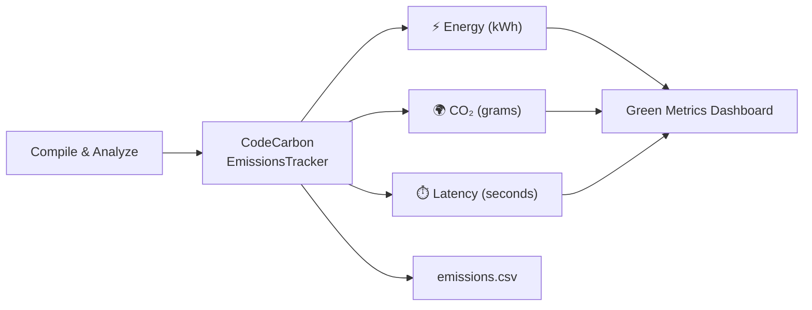

Every compile-and-analyze cycle measures:
- **Latency**: Wall-clock time from button press to result
- **Energy**: kWh consumed (via CodeCarbon hardware sensors)
- **Carbon**: gCO₂eq emitted based on regional grid carbon intensity

> The system includes an Apple M-Chip fallback: if hardware sensors are unavailable, safe presentation defaults are used so the dashboard always renders.

---

## 15. Configuration & Environment

### 15.1 Environment Variables

| Variable | Default | Purpose |
|---|---|---|
| `GEMINI_API_KEY` | — | Google Gemini API authentication |
| `GROQ_API_KEY` | — | Groq cloud provider |
| `OPENROUTER_API_KEY` | — | OpenRouter cloud provider |
| `GEMINI_MODEL` | `gemini-3.5-flash` | Primary Gemini model |
| `LIVE_MODEL` | `qwen2.5-coder:3b` | Ollama live suggestion model |
| `CODEGEN_MODEL` | `qwen2.5-coder:7b` | Ollama code generation model |
| `OLLAMA_HOST` | `http://localhost:11434` | Ollama server URL |
| `SEMANTIC_ANALYSIS_ENABLED` | `true` | Toggle semantic analysis |
| `REASONING_ENABLED` | `true` | Toggle reasoning pipeline |
| `REASONING_PROFILE` | `standard` | Default reasoning profile |
| `REASONING_GLOBAL_BUDGET` | `30` | Pipeline time budget (seconds) |

### 15.2 Sidebar Configuration

| Section | Controls |
|---|---|
| **Semantic Analysis** | Enable/disable, minimum confidence (LOW/MEDIUM/HIGH), include in AI review |
| **Deep AI Reasoning** | Enable/disable, profile (quick/standard/thorough) |
| **Live AI Suggestions** | Enable/disable, idle delay (1–5s), max suggestions (1–5) |
| **Provider** | gemini / ollama selection |
| **Model Selection** | Per-provider model for live, optimal, and chat tasks |
| **Provider Status** | 🟢 Running / 🟠 Model missing / 🔴 Not running |

---

## 16. Technology Stack

| Layer | Technology |
|---|---|
| **Frontend** | Streamlit + streamlit-ace (Ace Editor) |
| **Styling** | Custom CSS (25KB) + 5 theme schemes |
| **LLM (Cloud)** | Google Gemini (primary), Groq, OpenRouter |
| **LLM (Local)** | Ollama (qwen2.5-coder, llama3) |
| **Compiler** | GCC (g++) with `-g -fstack-protector-strong` |
| **Debugger** | LLDB (batch mode) |
| **AST Parsing** | tree-sitter-cpp (optional fallback to regex) |
| **Carbon Tracking** | CodeCarbon |
| **Security** | 50+ regex patterns, defense-in-depth |
| **Caching** | SHA-256 disk + in-memory dual-layer |
| **Data Formats** | JSON (interactions), CSV (errors), TOML (config) |

---

## 17. Key Design Decisions & Tradeoffs

| Decision | Rationale |
|---|---|
| **Gemini-first, Ollama-fallback** | Cloud gives faster, higher-quality responses; local fallback ensures offline capability |
| **SHA-256 disk cache** | Avoids redundant LLM calls for identical code + task combinations |
| **Tier ceiling from evidence** | Prevents LLM hallucination — an LLM cannot claim "definite error" without compiler confirmation |
| **Evidence gate before refutation** | Saves LLM calls by mechanically eliminating bogus candidates first |
| **Parallel refutation/fix/explain** | ThreadPoolExecutor with max 4 workers reduces wall-clock time |
| **Security scan before compile** | Prevents execution of dangerous code even if user attempts to bypass |
| **LLDB batch mode** | Prevents UI freeze from interactive debugger sessions |
| **Max 2 ReAct turns** | Bounds agentic behavior to prevent runaway costs |
| **Semantic auto-correction validation** | Corrected code must pass both security scan AND compiler syntax check |
| **Session state versioning** | `editor_version` counter forces Ace editor re-render on code updates |

---

> **Total Codebase**: ~5,500+ lines of Python across 20+ modules, plus 19 reasoning pipeline components, 6 test suites, and 25KB of custom CSS.
